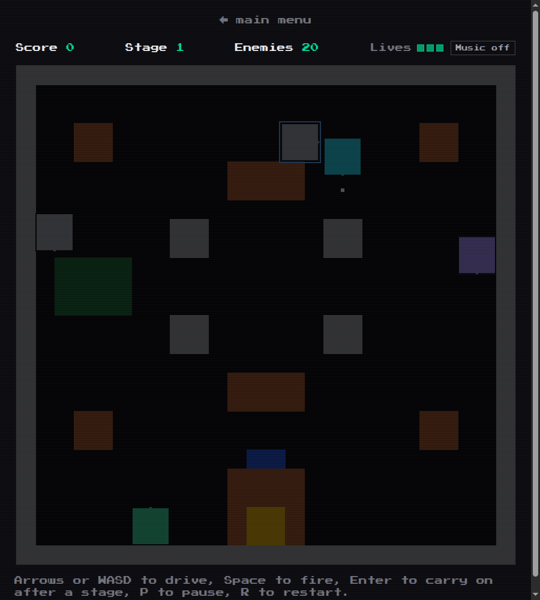
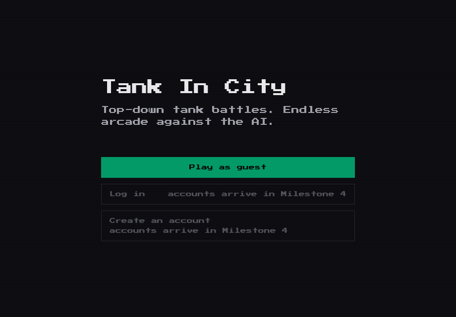
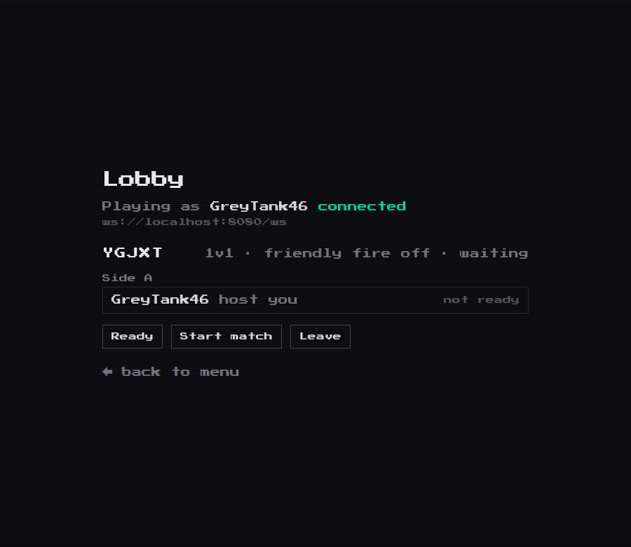

# Tank In City

Top-down tank battles. A Battle City-inspired arcade game: a deterministic Rust
engine compiled to WebAssembly, a Rust match server, and a Next.js front end.



## What it is

- **Battle City rules, original code and art.** Drive, shoot, protect your base,
  and fight through 20 enemies a stage, endlessly.
- **The engine is Rust compiled to WebAssembly**, and it is deterministic: a seed
  plus a list of inputs replays the same run, which is what makes the headless
  checks below possible at all.
- **The server runs the matches, not the browser.** Rooms, join codes, sides,
  ready and start live in a Rust `tokio` service, and a match is one 60 Hz world
  per room streaming `map` and `snapshot` frames over a WebSocket.
- **The 8-bit look is deliberate**: Press Start 2P everywhere, scanlines, a
  blinking prompt, and no easing anywhere — arcade machines snapped between
  states, they did not tween.

| Title | Lobby |
|---|---|
|  |  |

## What works today

| Part | State |
|---|---|
| Single Player | complete — plays on its own, no server needed |
| The lobby | create a room, join by code, 1v1 / 2v2 / 3v3 / free-for-all / co-op vs AI, sides, ready, host transfer, start |
| A match | the server runs it and streams it, but **the page that draws a *server* match is the next thing to build** — today only a socket client sees one |

`docs/deferred.md` is the honest list of everything known and deliberately not
done yet.

## Run it

Needs Rust with the wasm target, and Node 20 or newer. No `wasm-pack` and no
`wasm-bindgen`: the wasm is a plain `cargo build --target wasm32-unknown-unknown`.

```sh
rustup target add wasm32-unknown-unknown
cd web && npm install

cd web && npm run dev       # the game   -> http://localhost:3000
cd server && cargo run      # the server -> 127.0.0.1:8080
```

Pages: `/` title, `/menu`, `/game` (Single Player), `/lobby`. Only the lobby needs
the server running. `docs/running.md` covers the rest, including the checks and
how to put it on a public link with a tunnel.

## Checks

```sh
cd game-core && cargo test          # 37 tests: the engine, the type sizes, the stage data
cd server    && cargo test          # 44 tests: the room rules, the socket, the match loop
cd game-core && cargo clippy --all-targets   # must be silent
cd server    && cargo clippy --all-targets   # must be silent
cd web       && npm run check       # the wasm ABI, headless
cd web       && npm run check-audio # every sound trigger, headless
cd web       && npm run build       # production build
```

`npm run check-lobby` and `npm run check-match` drive the real protocol through a
socket — start the server first, or point them at a tunnel.

## Repo map

| Path | What is in it |
|---|---|
| `game-core/` | the engine: the tick loop, tanks, bullets, tiles, power-ups, scoring. Compiles to wasm |
| `server/` | the game server: rooms, the lobby protocol, the match loop |
| `web/` | the front end: canvas renderer, audio, the lobby, the check scripts |
| `docs/` | the milestone records, how to run it, what is deferred, the traps |
| `plan.md` | the milestone plan the work follows |

## Credits and licence

Every asset is listed one by one in `CREDITS.md`, with its author, source and
licence: the bundled sounds come from Sample Focus, PeriTune and Kenney, and the
font is [Press Start 2P](https://www.fontspace.com/press-start-2p-font-f11591) by
Cody "CodeMan38" Boisclair under the SIL Open Font License (the licence text
ships beside the file, in `web/app/fonts/OFL.txt`).

The code is MIT — see `LICENSE`.
