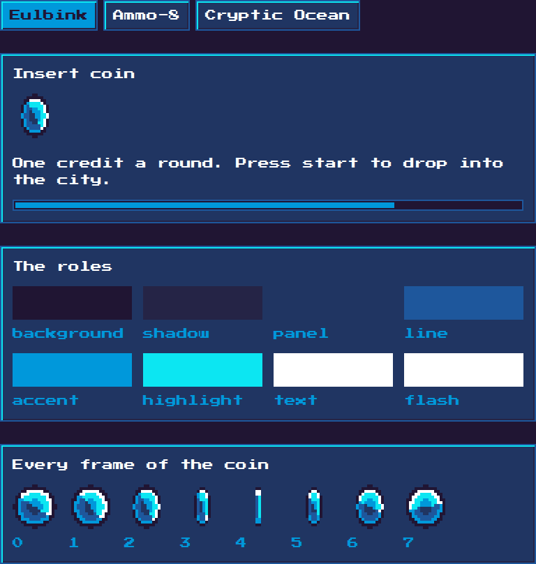

# Pixel UI

An 8-bit panel with three palettes behind a switch, built to a brief: **only
palette colours, only frame animation, only whole-number scaling.**

It lives on `/ui`, which is a demo page and a test bench at once: the panel, the
eight roles each palette fills, and all eight frames of the coin laid out side by
side rather than played.



## The roles are the interface

Eight role names. A theme fills them, and **nothing else in the UI names a
colour** — that is the whole reason three palettes swap without touching a
component or a rule.

| Role | What it is for |
|---|---|
| `background` | the void a panel sits on |
| `shadow` | the dark side of a bevel, and what a panel drops |
| `panel` | the surface of a panel or a button |
| `line` | borders and dividers |
| `accent` | the second colour: a caption, the bar's fill, the coin's body |
| `highlight` | the lit side of a bevel |
| `text` | body text |
| `flash` | the brightest step, for a title |

A palette shorter than eight colours repeats one across two roles. It still names
all eight, and `npm run check-pixel` fails if a theme misses one or if any file
under `web/components/pixel/` names a colour that is not in a palette.

## The palettes

| Theme | Author | Colours | |
|---|---|---|---|
| **Eulbink** | Inkpendude | 7 | **the default** |
| Ammo-8 | Ammo | 8 | the one the brief came with |
| Cryptic Ocean | Klafooty | 6 | |

Role by role:

| Role | Eulbink (default) | Ammo-8 | Cryptic Ocean |
|---|---|---|---|
| `background` | `#201533` | `#040c06` | `#2a173b` |
| `shadow` | `#252446` | `#112318` | `#3f2c5f` |
| `panel` | `#203562` | `#1e3a29` | `#443f7b` |
| `line` | `#1e579c` | `#305d42` | `#4c5c87` |
| `accent` | `#0098db` | `#4d8061` | `#95c5ac` |
| `highlight` | `#0ce6f2` | `#89a257` | `#69809e` |
| `text` | `#ffffff` | `#bedc7f` | `#95c5ac` |
| `flash` | `#ffffff` | `#eeffcc` | `#95c5ac` |

A repeated row is a palette with fewer colours than there are roles: Eulbink has
no white brighter than white, and Cryptic Ocean's one pale green has to carry
text, accent and flash. That is the palette being used as it wants to be, not a
gap.

The default is **Eulbink**, and it is not just a stored setting: it is the theme
a bare `.pixel` falls back to. A page that uses the panel with no script at all
is still themed, and the stored choice only catches up — no flash of an unthemed
panel. Exactly one theme file carries that bare selector, and the check fails if
two do.

## Adding a palette

One file, `web/components/pixel/<id>.css`, holding a `.pixel[data-theme="<id>"]`
block that fills the eight roles and points `--pixel-sheet` at its own coin.
Then:

```sh
cd web && npm run sprites      # draws that theme's coin sheet
cd web && npm run check-pixel  # proves it fills every role
```

Then one line in the switch in `PixelTheme.tsx`. Nothing else: the tooling reads
the CSS files to find the palettes, so there is no second list to keep in step,
and `make-sprites.mjs` refuses to run if a theme asks for a sheet it does not
write.

## The animations

| Animation | Frames | One frame | Cycle | What it is |
|---|---|---|---|---|
| `pixel-coin` | 8 | 130ms | 1040ms | the sprite strip stepping one frame left |
| `pixel-boot` | 6 | 120ms | 720ms | the panel revealed top to bottom, like a slow machine |
| `pixel-bar` | 8 | 110ms | 880ms | the insert-coin bar filling, then starting again |

Every one is `steps()`, and no easing curve appears anywhere in the panel's CSS —
the check fails the build if one does. All three sit between 4 and 12 frames at
80 to 150ms a frame.

Two rules make the pixels come out exact, and both are checked rather than
trusted:

- **Nothing blends.** No alpha between 0 and 1, no `opacity`, no filter, no blend
  mode, no gradient, and every `box-shadow` has 0 blur, so each of them writes
  whole pixels. The page the panel sits on also stands the site's scanline
  overlay down (`body:has(.pixel)::after`) — that overlay is white at 3%, which
  is not a colour in any of these palettes.
- **Whole numbers only.** The coin is a 16x16 frame drawn at 4x with
  `image-rendering: pixelated`, and the text is 16px — two steps of the pixel
  face's 8px design grid.

## Files

| File | What it is |
|---|---|
| `web/components/PixelPanel.tsx` | the panel, the coin and the bar — markup only |
| `web/components/PixelTheme.tsx` | the switch, and the `data-theme` it sets |
| `web/app/ui/page.tsx` | the demo page |
| `web/components/pixel/panel.css` | the structure and the rules |
| `web/components/pixel/<id>.css` | one file per palette |
| `web/scripts/palettes.mjs` | reads the theme files, so tools and browser agree |
| `web/scripts/make-sprites.mjs` | draws each theme's coin sheet, no dependencies |
| `web/scripts/check-pixel-ui.mjs` | `npm run check-pixel` |

Global CSS is imported by the component rather than a layout, per the Next docs
on global styles: they are never torn down on navigation, so every selector is
under the `.pixel` prefix and the file is harmless on any page.

## What was checked, and what it found

`npm run check-pixel` covers the source. The rendered pixels and the stepping
were checked in a real browser through the Playwright MCP server, on the built
site (`npm run build && npx next start -p 3009`), with every animation paused and
its `currentTime` set to a chosen millisecond.

**Frames step, they do not interpolate.** The coin's 1040ms is eight 130ms
frames, so frame 2 covers 260–390ms. Four times inside that frame — 265, 300,
340 and 385ms — came out **pixel-identical** to each other and to the frame's
midpoint (0 pixels differ). Each of the eight midpoints differs from its
neighbour by 608 to 1664 pixels. The bar behaved the same way: 30, 60 and 100ms
identical, 120ms (frame 1) different by 728 pixels.

**Every pixel of the panel is a palette colour.** Sixteen element screenshots —
eight coin frames and four bar frames — contain **no colour outside the palette
at all**. The 64x64 coin holds exactly six colours from a 16x16 sprite, which is
the proof that the 4x upscale is nearest-neighbour: any smoothing would have
invented intermediate colours.

**Every palette, not just the first.** For each of the three themes, every
element under `.pixel` (70 of them) was walked for colour, background, all four
border colours, outline, caret, `box-shadow` and `background-image`: 7 painted
colours for Eulbink, all 8 for Ammo-8, 6 for Cryptic Ocean, **none outside its
palette**, and no translucency, opacity, filter or blend mode anywhere. The three
sprite sheets were decoded by the browser and read back pixel by pixel: only the
theme's own colours, 1104 of 2048 pixels clear.

Also checked: the choice survives a reload (with `aria-pressed` back on the right
button), and `prefers-reduced-motion: reduce` turns all three animations off.

### The one thing that is not palette-exact, and why

A full-page screenshot is **0.98%** outside the palette — 9,776 pixels in a
million — and every one of them is on the edge of a letter. Point a crop at the
art and it is clean; point it at a heading and the fringes are there:

| Crop | Colours | Outside the palette |
|---|---|---|
| the coin, 64x64 | 6 | **0** |
| a title, 300x34 | 6 | 478 |
| the frame gallery, 700x90 | 10 | 308 (the frame numbers, not the coins) |
| empty margin, 50x50 | 1 | **0** |

Those fringe colours are the fingerprint of **subpixel (LCD) text anti-aliasing**
rather than a blend of two palette colours: `#fff5d6`, `#c5f5ff` and `#2755a4`
have single channels pinned while the others move, which is the red, green and
blue subpixels lighting unevenly along an edge.

This is the browser's font rasteriser, not the stylesheet. Nothing in CSS turned
it off on Linux: `-webkit-font-smoothing: none` (set on `.pixel`, and honoured on
macOS only), an exact `line-height`, integral element positions, and putting the
page on its own compositor layer with `transform: translateZ(0)` each changed the
count by **exactly nothing**. At 32px the edges are neutral greys (`#9f9f9f`)
rather than coloured fringes, so even the character of the fringing is the
rasteriser's business.

If a screen has to be 100% palette pixels and nothing else, there are three ways,
in order of how much they cost:

1. **Accept it.** Every surface, border, bevel, shadow and sprite is exact; only
   glyph edges are not, and that is true of every web game using a web font.
2. **A machine setting, for screenshots.** `--disable-lcd-text`, or fontconfig
   with anti-aliasing off, makes this machine render text without it. It is not
   something the page can ask for and it changes what every other site looks
   like, so it belongs to a verification run, not to the build.
3. **A bitmap font, if the rule is absolute.** The labels as 1-bit sprite masks
   (a mask plus `background-color` composites to one flat palette colour, with no
   blending). It is the honest 8-bit answer and it costs real text: no selection,
   no screen reader, no editing a label without redrawing it.
